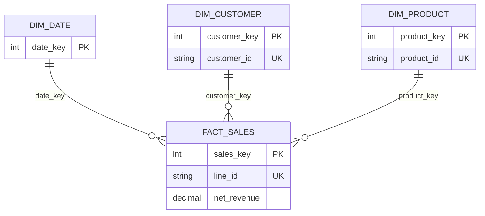

# Model notes

The fact grain is one product line on an order. Revenue and returns therefore aggregate
correctly by product, customer, region and date. `order_id` is intentionally degenerate:
it is useful for distinct-order measures but does not merit its own dimension.

Customer and product dimensions use surrogate keys so a later warehouse can adopt slowly
changing dimensions without rewriting the fact contract. This demonstration uses current
attributes (type 1) because the source does not provide change history.

